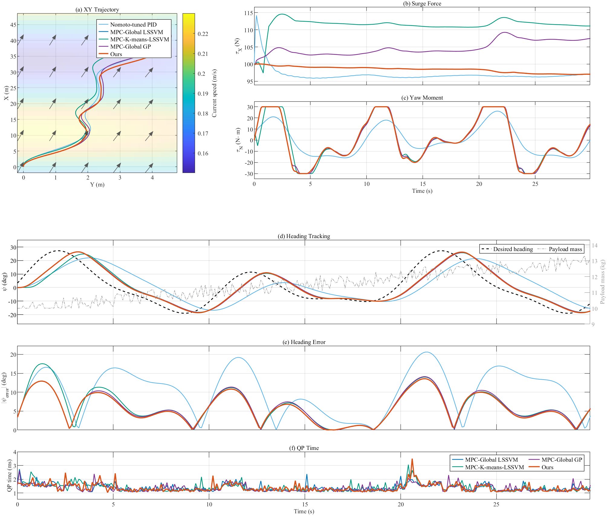
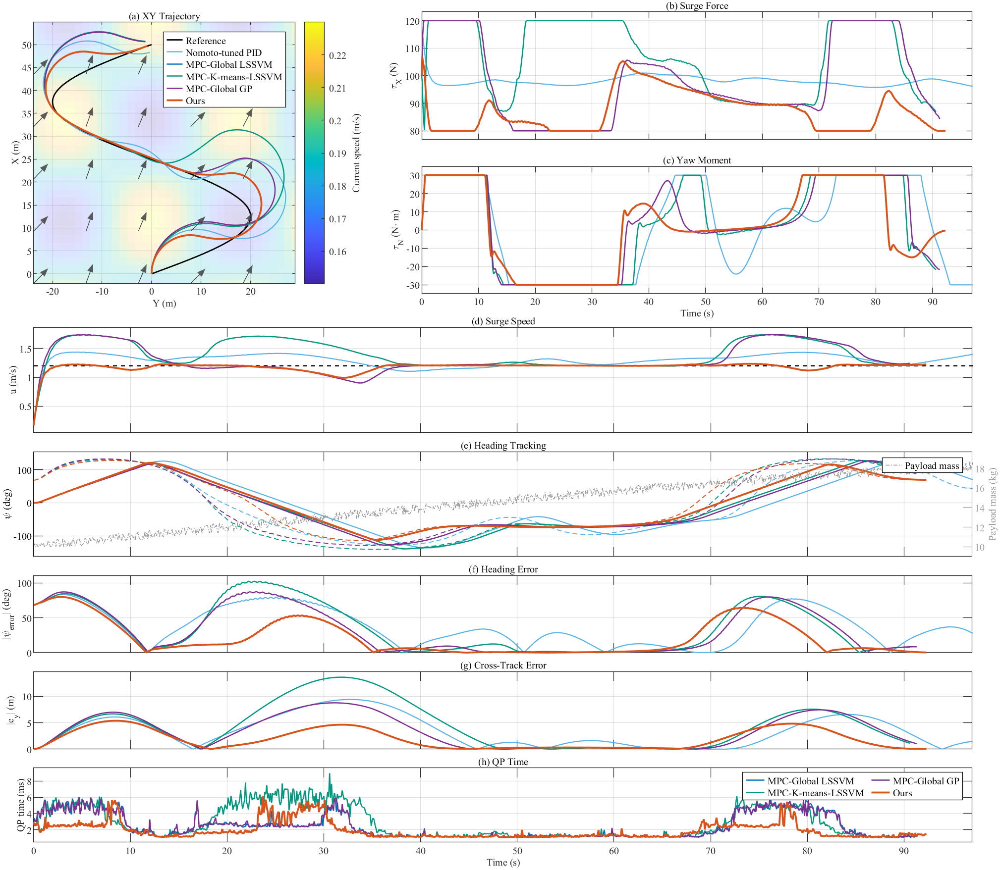

# Data-Driven Model Predictive Control of Differential-Thrust Unmanned Surface Vehicles via Local Affine Model Blending

**USV-Local-Affine-MPC** provides source code and simulation data for data-driven
MPC of differential-thrust USVs using local affine model blending.

This repository contains the MATLAB implementation for a soft-clustering-based
local linearization data-driven MPC method for differential-thrust unmanned
surface vehicles (USVs). The code supports data preparation, WFCM/K-means
clustering, LS-SVM and GP model learning, open-loop model validation, and
closed-loop MPC simulations under heading-tracking and path-following tasks.

## Highlights

- Weighted FCM (WFCM) with GA-optimized feature weights.
- Local linear LS-SVM models and membership-weighted model fusion.
- Global LS-SVM, K-means-LSSVM, Global GP, and Nomoto-tuned PID baselines.
- Heading-tracking and curve/path-following MPC scenarios.
- Spatial current and time-varying payload disturbance support.
- Single-run and repeated-run result saving, metric printing, and plotting from
  `.mat` result files.

<!-- RESULTS:START -->
## Results

Representative MSS heading-tracking and S-path-following experiments. Each preview shows the saved best run selected by the existing experiment scoring rule; the table reports mean +/- sample standard deviation across all 10 heading runs and 10 path-following runs.

### Heading tracking



### Path following



### Controller comparison

Lower is better. QP time is the per-run mean solver time, aggregated across the saved runs; it is not total controller latency. A dash means the PID controller does not solve a QP.

| Controller | Heading MAE (deg) | Path cross-track MAE (m) | Heading QP time (ms) | Path QP time (ms) |
| --- | ---: | ---: | ---: | ---: |
| Nomoto-tuned PID | 10.2971 +/- 0.0001 | 3.4088 +/- 0.0004 | - | - |
| MPC-Global LSSVM | 5.9756 +/- 0.0005 | 3.3912 +/- 0.0005 | 1.4388 +/- 0.1493 | 2.4348 +/- 0.0639 |
| MPC-K-means-LSSVM | 6.2809 +/- 0.0007 | 4.5003 +/- 0.0005 | 1.4676 +/- 0.1676 | 2.8991 +/- 0.0458 |
| MPC-Global GP | 5.9748 +/- 0.0005 | 3.3911 +/- 0.0005 | 1.4216 +/- 0.1481 | 2.4020 +/- 0.0431 |
| Ours | 5.7164 +/- 0.0004 | 1.9321 +/- 0.0002 | 1.4384 +/- 0.1683 | 1.9461 +/- 0.0393 |

Sources: [heading runs](results/mpc/mss/heading_multi_sine/repeatedMpcResults.mat), [path-following runs](results/mpc/mss/curve_sine_s/repeatedMpcResults.mat). These previews use included MSS results; USV-Simulator result files are also available under `results/mpc/usv_simulator/`.

Refresh these PNG previews and the table from the saved files:

```matlab
setupProject; exportReadmeResults;
```
<!-- RESULTS:END -->

## Repository Layout

| Path | Purpose |
| --- | --- |
| `setupProject.m` | Adds project folders and external dependencies to the MATLAB path. |
| `scripts/` | Top-level experiment scripts and default model-learning configuration. |
| `src/common/` | Shared path helpers, metrics, prediction utilities, and small tools. |
| `src/data_generation/` | MSS-based training and validation data generation. |
| `src/clustering/` | FCM/WFCM and K-means clustering. |
| `src/model_training/` | Global/local LS-SVM and GP model training. |
| `src/state_space/` | Extraction of affine state-space models from learned predictors. |
| `src/model_validation/` | Open-loop prediction validation and repeated-model statistics. |
| `src/guidance/` | Heading references, curve references, and Frenet-LOS guidance. |
| `src/mpc/` | Closed-loop simulation, MPC solvers, controllers, result saving, and plotting. |
| `data/` | Included MATLAB datasets for `mss` and `usv_simulator`. |
| `results/` | Included pretrained models and saved MPC results; exported figures are ignored by Git. |
| `external/` | Minimal third-party dependencies used by this project. |
| `docs/` | File-format notes and code-reading guides. |

## Requirements

The project is developed and tested in MATLAB on Windows.

Required MATLAB toolboxes:

- Statistics and Machine Learning Toolbox, for GP models and K-means.
- Fuzzy Logic Toolbox, for FCM clustering.
- Global Optimization Toolbox, for GA feature-weight optimization.
- Optimization Toolbox, for `optimoptions` during configuration and the
  `quadprog` fallback solver (also required by the current OSQP configuration).

Bundled or project-local dependencies:

- LS-SVMlab, installed separately in `external/LSSVM/` (not included in Git).
- MSS utility subset in `external/MSS/`.
- OSQP MATLAB interface in `external/osqp-matlab/` (bundled binary: Windows x64).

Before training, download LS-SVMlab from the
[official toolbox page](https://www.esat.kuleuven.be/sista/lssvmlab/toolbox.html)
and place its MATLAB files directly in `external/LSSVM/`, so that
`external/LSSVM/initlssvm.m` and `external/LSSVM/trainlssvm.m` exist.
Then run `setupProject` from the repository root. This local dependency folder
is ignored by Git and must be supplied separately after cloning the repository.

On other platforms, install a compatible OSQP MATLAB interface on the MATLAB
path or select `quadprog`. The bundled vendor tests and code-generation files
are not added to the runtime path.

If OSQP is unavailable, set the QP solver to `quadprog` in
`src/mpc/config_simulation.m`:

```matlab
param.qp_solver = 'quadprog';
```

## Quick Start

Open MATLAB in the repository root and initialize the path:

```matlab
setupProject;
```

### 1. Get Results Without Retraining

Datasets, pretrained models and saved MPC results are included in Git (about
77 MiB of MAT files). Run commands from the repository root in MATLAB.

To display a saved heading experiment and print its repeated-run statistics:

```matlab
setupProject; plotRepeatedMpcResultFile('results/mpc/mss/heading_multi_sine/repeatedMpcResults.mat');
```

For the saved path-following experiment:

```matlab
setupProject; plotRepeatedMpcResultFile('results/mpc/mss/curve_sine_s/repeatedMpcResults.mat');
```

These commands read saved results; they do not rerun simulations or training.
To recompute open-loop predictions using the included data and pretrained
models instead, run:

```matlab
setupProject; runFullPipeline;
```

The default configuration validates the USV-Simulator models, reports repeated
clustered-model statistics, and opens prediction plots. Training and data
generation are disabled by default. Model validation requires the MATLAB
toolboxes listed above; saved-result plotting does not train or load GP models.

### Optional: Regenerate MSS Data and Models

To regenerate MSS data and train all four MPC predictors, install LS-SVMlab as
described above and run:

```matlab
cfg = defaultExperimentConfig();
cfg.data.source = 'mss';
cfg.steps.generate_test_data = true;
cfg.steps.generate_training_data = true;
cfg.steps.train_nonclustered_lssvm = true;
cfg.steps.train_weighted_fcm_lssvm = true;
cfg.steps.train_weighted_fcm_lssvm_repeat = false;
cfg.steps.train_kmeans_lssvm = true;
cfg.steps.train_gp = true;
cfg.steps.validate_repeated_models = false;
runModelExperiment(cfg);
```

This regenerates MSS datasets and overwrites the corresponding trained models.
GA training can take substantial time. USV-Simulator datasets are already
included; collecting new ones requires the external simulator and the format
in `docs/DATASET_FORMAT.md`. ROS collection and control nodes are not included
in this MATLAB repository.

### 2. Run Open-Loop Model Validation

Edit the data source and pipeline switches in:

```text
scripts/defaultExperimentConfig.m
```

Common source choices:

```matlab
cfg.data.source = 'mss';
% or
cfg.data.source = 'usv_simulator';
```

Then run:

```matlab
runFullPipeline;
```

`validateModels(true)` validates the currently selected official models.

```matlab
validateModels(true);
```

`validateModels(true, true)` reads the saved repeated-model package and reports
mean +/- std for repeated clustered models.

```matlab
validateModels(true, true);
```

### 3. Run One MPC Experiment

The MATLAB closed-loop simulator uses MSS dynamics and MSS models regardless
of the model-learning data-source selection. The required MSS models are included.

Edit closed-loop settings in:

```text
src/mpc/config_simulation.m
```

Then run:

```matlab
runMpcSimulation;
```

The run saves:

```text
results/mpc/<source>/<scenario>/latestMpcResult.mat
```

The plotting and metric-printing functions can also read the saved file later:

```matlab
plotMPCResultFile('results/mpc/mss/heading_multi_sine/latestMpcResult.mat');
```

### 4. Run Repeated MPC Experiments

```matlab
runRepeatedMpcStats(10);
```

This saves:

```text
results/mpc/<source>/<scenario>/repeatedMpcResults.mat
results/mpc/<source>/<scenario>/bestMpcResult.mat
```

To plot the best run and print repeated-run statistics:

```matlab
plotRepeatedMpcResultFile('results/mpc/mss/heading_multi_sine/repeatedMpcResults.mat');
```

## Main Configuration Files

| File | Main parameters |
| --- | --- |
| `scripts/defaultExperimentConfig.m` | Data source, number of clusters, LS-SVM hyperparameters, WFCM GA settings, validation switches. |
| `src/mpc/config_simulation.m` | Sampling time, horizon, MPC weights, actuator constraints, OSQP settings, heading/curve scenario, current disturbance, payload disturbance. |
| `src/mpc/curveScenarioPreset.m` | Path-following scenario presets. |

Important default parameters include:

```matlab
% WFCM GA
population_size = 10;
max_generations = 30;
elite_count = 3;
weight_bounds = [0.25, 5];

% MPC / OSQP
Ts = 0.1;
Np = 30;
eps_abs = 1e-4;
eps_rel = 1e-4;
max_iter = 4000;
polish = true;
```

## Generated Model Layout

Learned artifacts are grouped by source:

```text
results/model_learned/mss/
results/model_learned/usvsimu/
```

Each source contains:

```text
trained_models/       LS-SVM and GP learned models
state_space_models/   Affine state-space models used by MPC
cluster_info/         Cluster centers, normalization ranges, labels, and WFCM weights
repeated_models/      Repeated clustered-model packages and summaries
```

## Data and Result Formats

See:

| Document | Description |
| --- | --- |
| `docs/DATASET_FORMAT.md` | Dataset matrix columns and validation-suite format. |
| `docs/MODEL_ARTIFACT_FORMAT.md` | Learned model, cluster metadata, and state-space model files. |
| `docs/MPC_RESULT_FORMAT.md` | Single-run and repeated-run MPC result structures. |
| `docs/CODE_STRUCTURE.md` | File-by-file reading guide. |

For external simulators or ROS environments, save a `.mat` file with the
`mpcResult` structure described in `docs/MPC_RESULT_FORMAT.md`; then reuse:

```matlab
plotMPCResultFile('your_result_file.mat');
```

## Included Data and Results

The following MAT files are versioned with the code:

- `data/**/*.mat`: training, validation and test datasets for both sources.
- `results/model_learned/**/*.mat`: pretrained predictors, cluster metadata,
  state-space models and repeated-model packages.
- `results/mpc/**/*.mat`: saved single-run and repeated-run MPC results.

Exported figures, temporary MAT files elsewhere, and the user-installed
`external/LSSVM/` dependency remain ignored. Rerunning training or simulation
can modify the versioned artifacts; commit those changes when updating the
shared experiment results.

## Citation

If this code helps your research, please cite the accompanying paper once it is
available.
